<a href="https://arhamazad2004.github.io">
  <picture>
    <source media="(prefers-color-scheme: dark)" srcset="assets/header-dark.svg" />
    
  </picture>
</a>

  <a href="https://arhamazad2004.github.io"><b>portfolio</b></a> &nbsp;·&nbsp;
  <a href="mailto:arhamazad2004@gmail.com"><b>email</b></a> &nbsp;·&nbsp;
  <a href="https://www.linkedin.com/in/arham-azad-4a678a305/"><b>linkedin</b></a>

I turn messy data and hard ideas into working, explainable software, and I build it fast: hackathon prototypes that actually run, algorithms you can watch, and AI that shows its reasoning.

### `~/now`

`building` [classified] &nbsp;·&nbsp; `learning` GitHub Foundations &nbsp;·&nbsp; `just finished` Goldman Sachs Risk Job Simulation

### `~/featured`

<a href="https://github.com/ArhamAzad2004/health-early-warning">
  <picture>
    <source media="(prefers-color-scheme: dark)" srcset="assets/project-dark.svg" />
    
  </picture>
</a>

### `~/recent`

<!-- recent:start -->
- `2026-11-09` **[health-early-warning](https://github.com/ArhamAzad2004/health-early-warning)**: Explainable, privacy-preserving early warning for population and workforce health risks (Dubai demo): multi-signal detection, back-tested alerts, role-based views
- `2026-11-08` **[Algorithm-Final-Project-](https://github.com/ArhamAzad2004/Algorithm-Final-Project-)**
- `2026-04-06` **[bsd404-project-Alogirthm-visualizer](https://github.com/ArhamAzad2004/bsd404-project-Alogirthm-visualizer)**: BSD 404 Algorithm Visualizer — Odd-Even Sort, FFT, Miller-Rabin
- `2026-01-20` **[layout-similarity-faiss](https://github.com/ArhamAzad2004/layout-similarity-faiss)**
- `2025-06-02` **[Ai-powered-learning-app](https://github.com/ArhamAzad2004/Ai-powered-learning-app)**
<!-- recent:end -->

### `~/projects`

- **[sentinel-dubai](https://github.com/ArhamAzad2004/health-early-warning)**: explainable early warning for population health. On simulated data it caught both test outbreaks 3–5 days early with 80% precision. `Python` `Docker`
- **[algorithm-visualizers](https://github.com/ArhamAzad2004/Algorithm-Final-Project-)**: FFT, Miller-Rabin, Rabin-Karp and Metric TSP made interactive. Single HTML files, zero dependencies. `JavaScript`
- **[medgenius](https://github.com/ArhamAzad2004/medgenius)** ([demo](https://medgenius-demo.vercel.app)): team-built health assistant for report analysis, trends and medicine scanning. `Next.js` `Supabase`
- **[ai-movie-guide](https://github.com/ArhamAzad2004/AI-MovieGuide)**: ask for a movie in plain English. GPT works out what you mean and TMDb finds the top five. `Python` `OpenAI`
- **`[classified]`**: something new. Data, AI and a problem worth solving.

### `~/certs`

- **Python for Data Science, AI and Development**, IBM · Coursera, 2024 · [verify](https://coursera.org/verify/467DSP8VRGK3)
- **Fundamentals of Agents**, Hugging Face, 2025 · [view](https://arhamazad2004.github.io/assets/hf-agents-cert.webp)
- **Risk Job Simulation**, Goldman Sachs · Forage, 2026 · [view](https://arhamazad2004.github.io/assets/gs-risk-cert.webp)
- GitHub Foundations · *in progress*

<b>Hiring?</b> Why I'd fit

 

- Graduating 2026. Ready for internships now and full-time after.
- Ships end to end: Python back ends, TypeScript front ends, Docker and tests.
- Certified and still learning: IBM data science, Hugging Face agents, more in progress.

<b>Building something?</b> Let's talk

 

- Idea to working demo fast, hackathon-proven.
- Data and UI in one person, so nothing gets stuck between the two.
- I test, validate and document, so the team can trust what ships.

[Pitch me your idea →](mailto:arhamazad2004@gmail.com?subject=Let's%20build%20something)

 

<picture>
  <source media="(prefers-color-scheme: dark)" srcset="https://raw.githubusercontent.com/ArhamAzad2004/ArhamAzad2004/output/snake-dark.svg" />
  
</picture>
